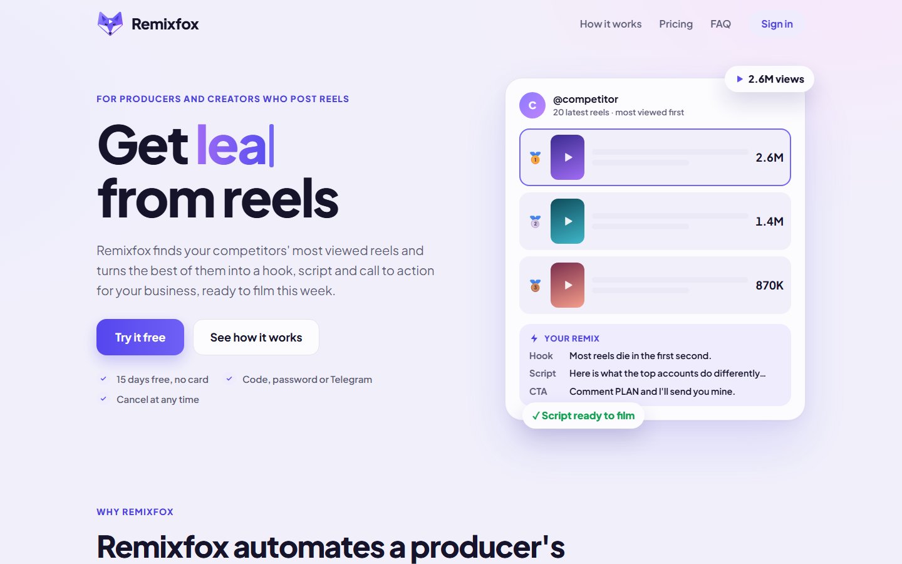
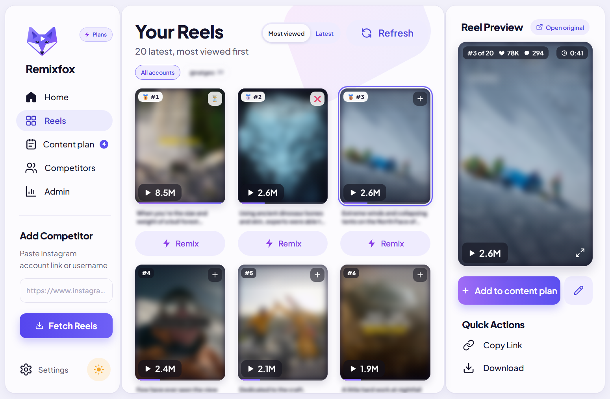
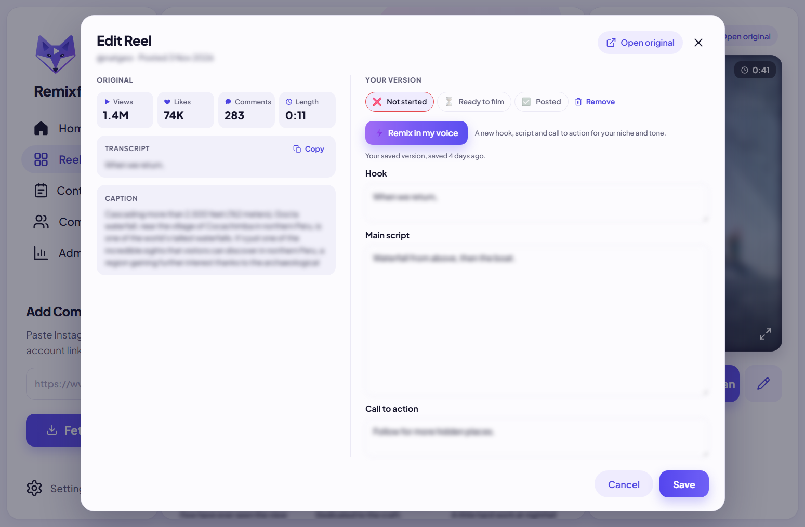
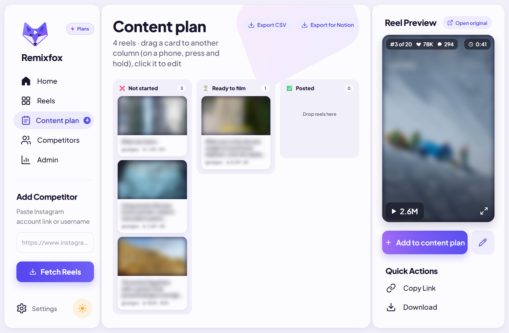
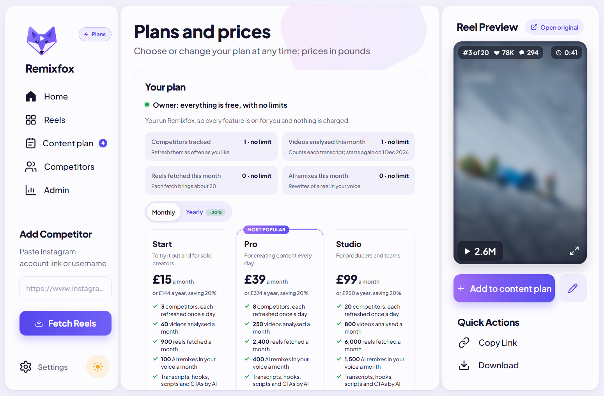
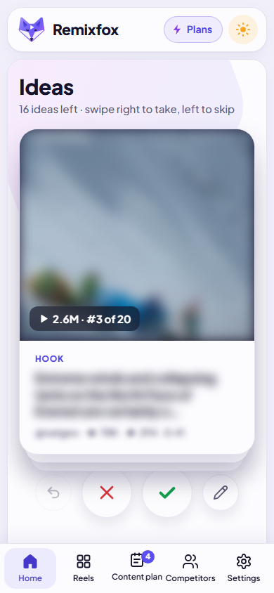
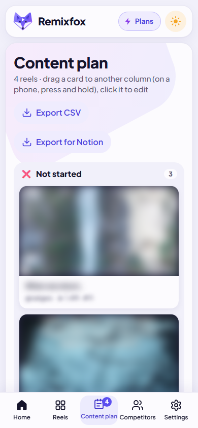
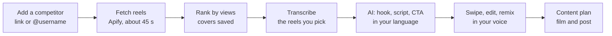
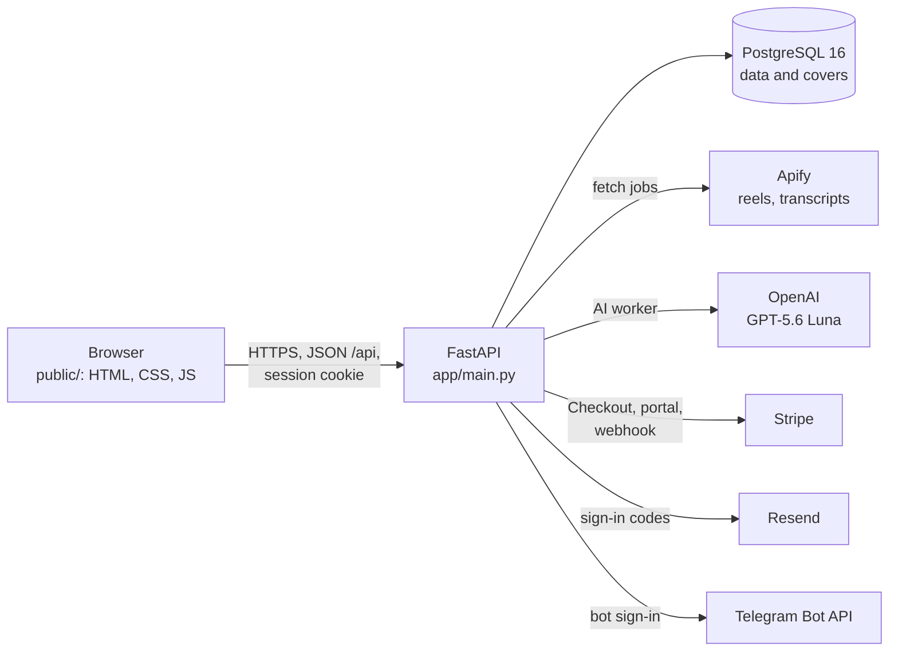

<div align="center">


# Remixfox

**AI-powered Reels research and content creation**

Remixfox finds your competitors' most viewed Instagram reels and turns the best of them into a hook,
script and call to action for your business, ready to film this week.

[**remixfox.co.uk**](https://remixfox.co.uk) · [API reference](https://remixfox.co.uk/api/docs) · [Changelog](CHANGELOG.md)

[](https://remixfox.co.uk)
[](requirements.txt)
[](app/main.py)
[](docker-compose.yml)
[](render.yaml)
[](https://github.com/OlehDatsyk/Remixfox-public/actions/workflows/tests.yml)


</div>

---

> **About this repository.** This is the public source of Remixfox. The live service at
> [remixfox.co.uk](https://remixfox.co.uk) runs the same code from a private repository; this copy leaves out
> internal notes and deployment settings, and its legal pages do not carry the operator's street address
> (the live site does). It is published to read, not to reuse: see [Licence](#licence).

## Contents

[What it does](#what-remixfox-does) · [Product tour](#product-tour) · [Features](#main-features) · [How it works](#how-it-works) ·
[Architecture](#architecture) · [Stack](#technology-stack) · [Structure](#project-structure) · [Run locally](#running-it-locally) ·
[Environment](#environment-variables) · [Integrations](#api-and-integrations) · [Deployment](#deployment) ·
[Security](#security-and-privacy) · [FAQ](#faq) · [Contact](#contact) · [Licence](#licence)

## What Remixfox does

Producers and creators spend days finding what works in their niche, transcribing videos and writing scripts.
Remixfox does the slow part:

1. You add a competitor's Instagram account.
2. Remixfox fetches their latest reels with views, likes and comments, ranked by views.
3. It transcribes the reels you pick, and the AI splits each one into a **hook**, a **main script** and a **call to action**,
   translated into your language.
4. You keep the ideas you like, rewrite them (or let the AI remix them in your own voice) and track them on a content plan
   until they are filmed and posted.

It is a small subscription product: a 15-day free trial, then Start, Pro or Studio, monthly or yearly, paid through Stripe.

## Product tour

Real screens of the app, captured from a local copy. The covers, captions, transcripts and handles of the reels in
these shots are blurred: they belong to their creators, and Remixfox is for learning from them, not republishing them.

<table>
  <tr>
    <td width="50%"><br><sub><b>Landing page.</b> What it does, how it works, pricing, FAQ and sign-in on one page.</sub></td>
    <td width="50%"><br><sub><b>Reels.</b> A competitor's latest reels ranked by views, with a preview.</sub></td>
  </tr>
  <tr>
    <td><br><sub><b>Editor.</b> The original (numbers, transcript, caption) beside your hook, script and CTA, with "Remix in my voice".</sub></td>
    <td><br><sub><b>Content plan.</b> Not started, ready to film, posted: drag cards between columns.</sub></td>
  </tr>
  <tr>
    <td><br><sub><b>Plans.</b> Usage against the plan, three plans, monthly or yearly.</sub></td>
    <td align="center"> <br><sub><b>On a phone.</b> Swipe ideas right to keep them; the board in one column.</sub></td>
  </tr>
</table>

## Main features

| Feature | What you get |
|---|---|
| **Competitor research** | Add any public Instagram account by link or @username; each fetch brings its 20 latest reels (pinned ones skipped). |
| **Reels analytics** | Views, likes, comments and length; a rank and a bar for every reel; "Most viewed" or "Latest"; filter by account. |
| **Transcription** | Speech-to-text for the reels you choose, fetched once and kept. |
| **AI scripts** | Each transcript split into hook, main script and call to action by OpenAI's GPT-5.6 Luna. |
| **Translation** | Scripts and captions in British English, Ukrainian, Spanish, French, German, Italian or Portuguese. A transcript already in your language is kept word for word. |
| **Remix in my voice** | A rewrite for your niche, audience and tone ("Your voice" in Settings), keeping what made the original work without copying it. |
| **Swipe ideas** | Home shows the best ideas one at a time: right to keep, left to skip, Backspace to undo. |
| **Content plan** | A board with ❌ Not started, ⏳ Ready to film and ✅ Posted; export to CSV (Pro, Studio) or Notion (Studio). |
| **Accounts** | Sign in with a code by e-mail, a password, or a Telegram bot; the first sign-in creates the account. |
| **Plans and billing** | A 15-day trial, three plans in pounds, Stripe Checkout (with the UK's 14-day cancellation consent), switching in place and Stripe's billing portal. |
| **Admin panel** | For the owner and up to 10 admins: payments, revenue, MRR, users by plan, reels and what Apify and OpenAI cost. |

## How it works



Every fetch is shown live in an activity panel: each step with its state, timing, counts and the server's log.

## Key product capabilities

- **Honest limits:** each competitor can be fetched once a day; plans cap competitors, reels, videos and AI remixes a month
  (`app/plans.py`), counted from usage records that survive deletions, so removing and re-adding gives nothing back.
- **Costs under control:** a fetch of 20 reels costs about $0.05 at Apify, a transcript about $0.05 a minute, the AI about
  $0.0002 a reel; a test checks that every plan stays profitable even at full use.
- **Your text is never overwritten:** the AI's version fills only empty fields, and a remix is saved only when you press Save.
- **Smooth on every screen:** the 1549 x 1015 desktop design scales to the window; tablets and phones have their own layouts
  with a bottom tab bar, a sized swipe deck and press-and-hold dragging.

## Architecture

One Docker container serves the API, the front end and two kinds of background work; PostgreSQL holds the data and the covers.



More in [`docs/ARCHITECTURE.md`](docs/ARCHITECTURE.md).

## Technology stack

| Layer | Choice |
|---|---|
| Back end | Python 3.12, FastAPI, SQLModel and SQLAlchemy 2, Alembic migrations, httpx |
| Database | PostgreSQL 16 (psycopg 3) |
| Front end | Plain HTML, CSS and JavaScript: no framework and no build step; a local copy of Plus Jakarta Sans |
| Hosting | Docker on Render (web service and database) |
| Services | Stripe (payments), Apify (Instagram data), OpenAI (AI), Resend (e-mail), Telegram Bot API (sign-in), all over plain HTTP |
| Tests | pytest against a real PostgreSQL, with Apify, Stripe, OpenAI, Resend and Telegram faked |

## Project structure

```
Remixfox/
├── app/                    FastAPI back end
│   ├── main.py             the app, pages, security headers
│   ├── auth.py             accounts, sessions, roles, limits
│   ├── email_login.py      6-digit codes by e-mail
│   ├── passwords.py        optional passwords (scrypt)
│   ├── telegram.py         sign-in through the bot
│   ├── plans.py            plans, prices, trial and usage
│   ├── billing.py          Stripe: Checkout, portal, webhook
│   ├── api.py              competitors, reels, plan, jobs, exports, admin
│   ├── jobs.py             the fetch pipeline and its step log
│   ├── apify.py            the Apify client
│   ├── ai.py               the OpenAI worker and the remix
│   ├── transcripts.py      one transcript on request
│   ├── translations.py     the AI queue and languages
│   ├── storage.py          covers kept in PostgreSQL
│   └── models.py, db.py, config.py, handles.py
├── public/                 the front end (served at /)
│   ├── index.html, app.js, styles.css       the app
│   ├── welcome.html, welcome.js, welcome.css the landing page
│   ├── legal.html, privacy.html, terms.html  legal pages
│   └── 404.html, robots.txt, sitemap.xml, logo.svg, og-image.png, fonts/
├── alembic/                database migrations
├── tests/                  pytest suite
├── docs/                   architecture, API, testing; assets/ (screenshots)
├── Dockerfile, start.sh, docker-compose.yml, render.yaml
└── .github/workflows/tests.yml
```

## Running it locally

Requires Docker Desktop (and Python 3.12 for the tests).

```bash
cp .env.example .env          # fill in what you need; everything is optional locally
docker compose up --build     # the app and PostgreSQL
```

Open http://localhost:8080 and sign in with any e-mail: without `RESEND_API_KEY` the code is printed in
`docker compose logs web`. `owner@example.com` is the local owner. Fetching real reels needs `APIFY_TOKEN` and costs
Apify credit; scripts need `OPENAI_API_KEY`.

Tests:

```bash
docker compose up -d db
pip install -r requirements-dev.txt
pytest
```

## Environment variables

| Variable | Needed for |
|---|---|
| `DATABASE_URL` | everything (set by Docker Compose locally) |
| `SECRET_KEY` | hashing sign-in codes, the Telegram webhook secret |
| `PUBLIC_URL` | the site's own address (pages opened at the host's default address redirect there) |
| `OWNER_EMAIL` | which account owns the app (free, no limits, the Admin panel) |
| `APIFY_TOKEN` | fetching reels and transcripts |
| `AUTO_TRANSCRIBE` | transcripts after each fetch (default `true`) |
| `OPENAI_API_KEY` | AI scripts, translations and remixes |
| `STRIPE_SECRET_KEY`, `STRIPE_WEBHOOK_SECRET` | payments (use test keys locally) |
| `RESEND_API_KEY` | sign-in e-mails |
| `TELEGRAM_BOT_TOKEN` | Telegram sign-in |

Never commit real keys; [`.env.example`](.env.example) holds placeholders only.

## API and integrations

Everything is under `/api`, JSON in and out; the interactive reference is at [`/api/docs`](https://remixfox.co.uk/api/docs)
and every endpoint and status code is listed in [`docs/API.md`](docs/API.md).

| Service | Used for | How |
|---|---|---|
| Apify (`apify~instagram-reel-scraper`) | latest reels, transcripts | `app/apify.py`, a spending cap on every run |
| OpenAI Responses API (GPT-5.6 Luna) | hook, script, CTA, translation, remix | `app/ai.py`, strict JSON schema, results checked before saving |
| Stripe | Checkout, plan switches, billing portal, webhook | `app/billing.py`, no SDK, signatures checked by hand |
| Resend | sign-in codes by e-mail | `app/email_login.py` |
| Telegram Bot API | sign-in through a bot | `app/telegram.py`, secret webhook header |

Remixfox is not connected with or endorsed by Instagram or Meta. It reads public data through Apify, so what it can show
depends on what Instagram makes public and on Apify being available.

## Deployment

The image is a plain Docker build: `start.sh` runs the migrations, then uvicorn on `$PORT`. [`render.yaml`](render.yaml)
describes a Render web service and PostgreSQL database as a Blueprint; set the variables above in the host's
environment, add your own domain and point `PUBLIC_URL` at it. The health check is `/api/health`.

In this repository, GitHub Actions only runs the tests ([`tests.yml`](.github/workflows/tests.yml)); nothing deploys from it.

## Security and privacy

- Sign-in codes are stored only as keyed hashes; passwords as scrypt hashes; sessions as SHA-256 hashes in an httponly,
  SameSite cookie. Codes, passwords and Telegram sign-ins are rate limited.
- Every user sees only their own data; paid features and limits are checked on the server.
- HTTPS only with HSTS, a Content Security Policy, `X-Frame-Options`, `nosniff` and a strict referrer policy.
- Card details never reach Remixfox: Stripe hosts the payment page, and the webhook's signature is checked.
- The signed-in app is kept out of search engines; only the landing and legal pages are indexed.

Details in [`SECURITY.md`](SECURITY.md); what the live service keeps and why is in its
[Privacy policy](https://remixfox.co.uk/privacy.html).

## FAQ

**Which Instagram accounts work?** Public accounts that post reels. Private accounts cannot be fetched, and Remixfox never
asks for an Instagram password.

**How fresh are the numbers?** They are Instagram's public counts at the moment of each fetch; fetch again (once a day per
competitor) for fresh ones.

**What does a fetch cost to run?** About $0.05 at Apify for 20 reels; transcripts about $0.05 a minute of video.

**Can I use this code for my own product?** No: the source is public to read, but all rights are reserved (see below).

More questions for customers are answered on the [landing page](https://remixfox.co.uk/#faq).

## Contact

Oleh Datsyk: oleh@remixfox.co.uk (see the [Legal notice](https://remixfox.co.uk/legal.html)). To report a security
problem, see [`SECURITY.md`](SECURITY.md).

## Licence

Proprietary: © 2026 Oleh Datsyk, all rights reserved (see [`LICENSE`](LICENSE)). The source is published for reading;
copying, modifying or redistributing it needs written permission. The Plus Jakarta Sans font is under the SIL Open Font
License (`public/fonts/OFL.txt`).
